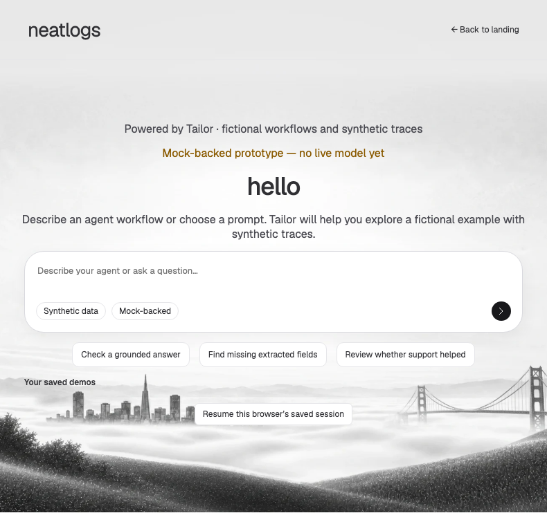
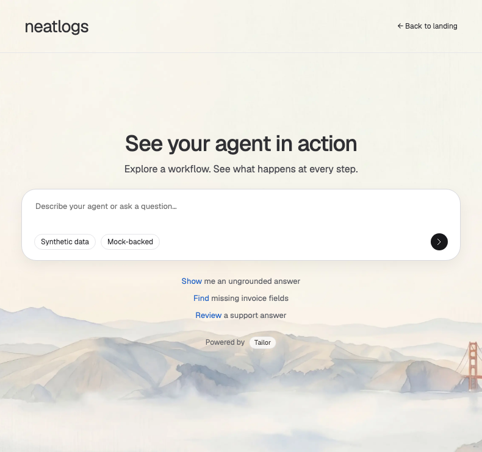

# Tailor entry annotation review — 12 October 2026

Base: `17e40c29d5bb655c7df2acc0662d178f1b126abe` on `codex/tailor-20261012-integration`. Local and origin tips matched at two read-only checks before the fixes. Review branch: `codex/tailor-20261012-review-fixes`, in the primary repository's `.claude/worktrees/tailor-20261012-review-fixes`. Existing worktrees, publication operations and port 4323 were preserved.

| Comment | Requested change and fix | Files | Evidence |
| --- | --- | --- | --- |
| 1 | Replace weak copy; retain Powered by Tailor with a background pill around Tailor. Marketing message becomes “See your agent in action” and “Explore a workflow. See what happens at every step.” | `src/clients/neatlogs/client.ts`, `public/style.css` | Entry hierarchy test; after screenshots at all three sizes |
| 2 | Remove redundant top prototype warning. Composer retains server-authoritative Mock-backed / Live model / Provider status unavailable and Synthetic data. | `src/clients/neatlogs/client.ts`, `ui/agent.spec.ts` | Provider-label failure/malformed-response tests; entry hierarchy test |
| 3 | Move attribution from above headline to below suggestions. Overlaps comment 1. | `src/clients/neatlogs/client.ts`, `public/style.css` | Position assertion and after screenshots |
| 4 | Replace “hello” with “See your agent in action”. | `src/clients/neatlogs/client.ts`, existing UI specs | Heading assertions and after screenshots |
| 5 | Use the actual observed Neatlogs AI-search watercolor background instead of its landing photo. | `public/assets/ai-search-background.webp` and provenance JSON, `public/style.css` | Reference observed read-only; asset URL assertion; before/after screenshots |
| 6 | Short subtitle and centered heading/composer hierarchy follow the reference chat composition. Overlaps 4 and 5. Entry-only styles preserve the dock. | `src/clients/neatlogs/client.ts`, `public/style.css` | Subtitle/layout assertions, three viewport screenshots |
| 7 | Hide Your saved demos until valid server-owned saved demos exist; retain picker when demos exist without active selection. | `src/clients/neatlogs/entry-state.ts`, `client.ts`, CSS hidden override | Unit validity checks; fresh/expired/failure browser tests; real saved-demo journey |
| 8 | Six grounded question variants rotate in two vertical batches of three every eight seconds. Clicking fills editable input without submission. Pause during hover/focus/editing, background tab or reduced motion; stop on navigation; resume on persisted pageshow. | `entry-state.ts`, `client.ts`, CSS, helper unit tests | Six prompts through real offline intent policy; browser rotation, editing, reduced-motion and page-lifecycle checks |
| 9 | Show Resume only for active server selection matching an owned demo; refresh ownership before opening. Selecting a directly opened demo updates active selection rather than leaving Resume pointed elsewhere. Overlaps 7. | `entry-state.ts`, `client.ts` | Stale/empty/expired/failure tests, browser isolation, real active-selection regression |

Before/after evidence at the annotation viewport:

[Desktop before](tailor-entry-review/before-1440.png) · [Desktop after](tailor-entry-review/after-1440.png) · [Mobile before](tailor-entry-review/before-390.png) · [Mobile after](tailor-entry-review/after-390.png).

The Neatlogs reference was inspected live at https://app.neatlogs.com/ai-search. Exact observed light background acquired; centered hierarchy and vertical rotating suggestions reproduced. This is a bounded entry comparison, not certification of every Neatlogs pixel, theme or app surface. Navigation and existing dock remain outside these annotations.

Parallel ownership: GPT-6.1-sol orchestrator owned tests, the explicit browser helper route, assets and evidence; GPT-6.1-sol behavior agent owned client/helper/unit tests; GPT-6-luna style agent owned CSS; GPT-6.1-sol independent reviewer read only. Review found a missing helper route, bfcache timer restart gap and same-current selection mismatch; all were repaired. Final independent diff review has no remaining concrete findings.

Focused validation: 7 helper/capability tests passed; 5 initial focused browser checks passed after correcting the helper route; 8 expanded browser checks passed after lifecycle/selection repairs. Existing assertions were updated for the requested copy and warning removal while retaining provider/synthetic assertions. No tests were skipped or weakened to bypass failures. Final-commit typecheck, build, full unit and full UI results are recorded by the final execution and local `.local/review-evidence/final-validation.json`.

Entire best effort: CLI 0.11.4; caller-env identifies this caller session on the original Codex checkout, with 0 recorded turns/checkpoints and unchanged lifecycle timestamp at observation. Capture for this review worktree is unverified. Existing tracking metadata/hooks were preserved; no manual hook execution, import, attach, trailer manufacture, history rewrite or push occurred. No claim of remote checkpoint sync or dashboard ingestion.

All servers/tests use mock mode and captured local telemetry. Final validation and preview explicitly remove paid-provider and hosted-export keys from their environment. No paid E2E, hosted exports, merge, push or deployment. The final verified preview URL is supplied in the final response.
