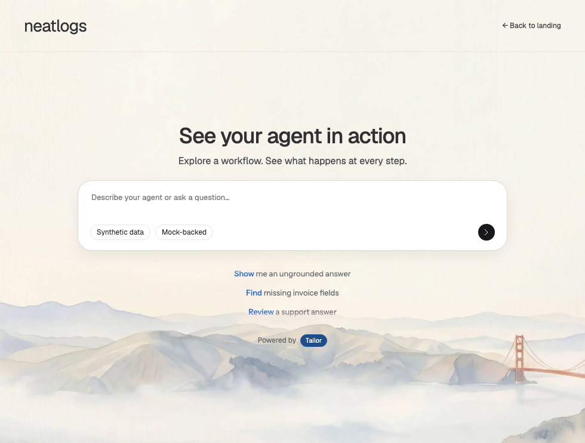

# Entry suggestion motion — 12 October 2026

Base `e67851cae5799e5fb0de2e9d08d5ac4861545b8a`; isolated `codex/tailor-20261012-review-fixes` worktree. Existing worktrees and port 4323 preserved.

- [x] Comment 1: automatically scroll questions with blur, matching the official entry treatment and typography. The two supported batches of three now move upward and blur out before the next batch enters from below, with a short row stagger. The bounded 100px window has the official top/bottom gradient mask, 32px rows and Instrument Sans at 13px/20px. The actual observed Latin font is self-hosted with its OFL license and source/hash metadata. No remote font request occurs in the local app.
- [x] Comment 2: improve the Tailor pill color. The entry attribution now uses deep blue with white text; attribution wording and placement stay intact. This overlaps the suggestion color treatment and uses the same blue family.

| Annotation | Files | Verification |
| --- | --- | --- |
| 1 — scrolling, blur and typography | `src/clients/neatlogs/client.ts`, `public/style.css`, `public/assets/instrument-sans*` | Phase sequencing preserves old text until exit completes; six supported questions; hover/focus/edit/touch hold pauses; preference change cancels; reduced motion static; no automatic send; lifecycle cleanup and browser isolation |
| 2 — Tailor pill | `public/style.css` | Entry-only deep blue `#1d4e89`, white text; viewport screenshots and computed contrast test |
| Regression | `ui/entry-review.spec.ts`, `ui/suggestion-motion.spec.ts` | Existing ownership and no-auto-submit assertions retained; successful rotation checks allow the newly required exit duration rather than expecting instantaneous replacement |

Reference: [official Neatlogs AI search](https://app.neatlogs.com/ai-search), inspected read-only in the signed-in browser. The rendered rows expose upward transform/opacity/blur animation and the measured mask/font/row dimensions above. No reference prompts were sent. Local motion uses an eight-second reading interval, a 310ms staggered exit and a 470ms staggered entrance; these are authored local timings, not a claim of exact official frame timing.

Interaction immediately cancels blur/movement and restores readable text. A touch hold also blocks the next cycle until pointer release/cancel. Hidden/offscreen views stop animation, navigation removes timers/listeners/observer, and capability repaint restarts one rotation. Focus unmasks the viewport so the keyboard outline remains visible. Paid API calls, hosted telemetry, grounding, blocking intent checks and session behavior are unchanged.

Evidence: supplied annotated screenshots are the before reference. Final after screenshots and genuine natural-motion video are stored in `.local/review-evidence/motion-*`; intermediate screenshots use deterministic paused animation seeking and do not prove natural frame pacing. 14 focused browser tests and four grounded entry unit checks passed before commit. [Genuine motion recording](tailor-motion-review/motion-natural.webm) · [Mobile](tailor-motion-review/motion-after-390.png) · [Outgoing sample](tailor-motion-review/motion-after-980-exit.png) · [Incoming sample](tailor-motion-review/motion-after-980-enter.png).

Full final-commit check logs/results are in `.local/review-evidence/motion-final-validation.json`.

Models and ownership: GPT-6.1-sol orchestrator owns client behavior, assets and evidence; GPT-6-luna owns bounded CSS changes; GPT-6.1-sol behavior agent owns browser tests; GPT-6.1-sol independent reviewer is read-only. Root added the final focus overflow/medium accent-weight rules after CSS ownership returned. Independent review verified touch interruption in Chromium and found no remaining concrete issue.

Mock provider and captured local telemetry only, paid/hosted keys removed. No merge, push, deployment or paid E2E. Entire is best effort: caller metadata resolves the original 788e checkout, so live capture in this review worktree remains unverified. Normal-hook commit linkage is checked without manual trailers, imports, hook changes or history rewriting.
