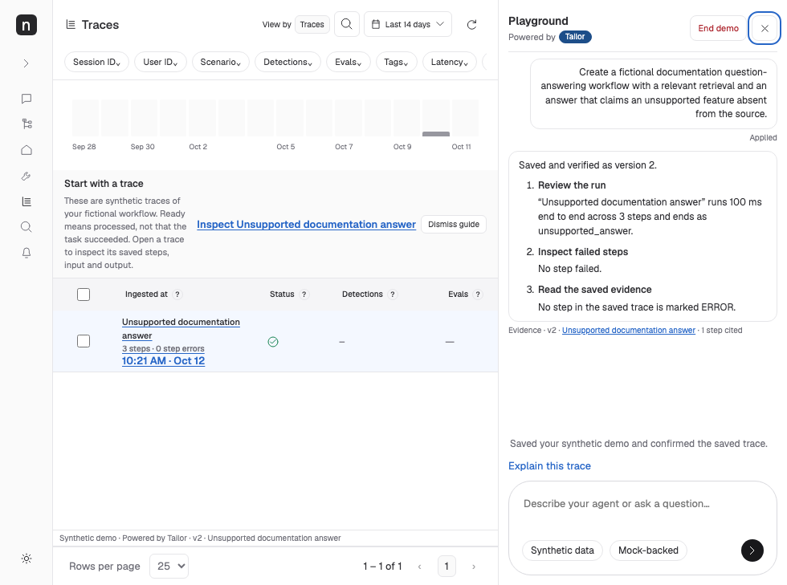

# Playground header and result clarity — 12 October 2026

Base `2158335c03fac8b856a354c4e3b25564f87846ba`; same isolated `codex/tailor-20261012-review-fixes` worktree. Existing worktrees and port 4323 preserved. Impeccable polish/clarify guidance used, retaining the Neatlogs visual system.

- [x] Comment 1: replace the cryptic “Checked · Saved · Verified ✓ · Read the trace” chain with one plain-language result. A confirmed save says “Saved your synthetic demo and confirmed the saved trace.” Read-only answers explain the knowledge/trace lookup and say nothing changed. Uncertain saves, failed writes, conflicts, clarification and refusals retain their distinct honest meanings. Unknown or incomplete results never acquire a guessed success.
- [x] Comment 2: repair the Playground header hierarchy and controls. Title and attribution sit on distinct lines; the Tailor pill uses the established accessible blue; a subtle divider separates the conversation. End demo and close remain distinct, with visible keyboard focus and 32px targets. Neither overlaps or clips the attribution at tested widths.

| Annotation | Files | Verification |
| --- | --- | --- |
| 1 — clear result | `src/clients/neatlogs/turn-summary.ts`, `client.ts`; module route in `src/infrastructure/server.ts` | Six unit tests for all outcomes, latest step evidence, skipped/missing steps and inert private details; exact UI summary retained after reload/collapse/reopen |
| 2 — header layout | `public/style.css` | Measured stacked title/attribution, containment, no overlap or clipped attribution; 320/390/980/1440px screenshots plus dark header/summary |
| Regression | `test/turn-summary.test.ts`, `test/ui-asset-cache.test.ts`, `ui/agent.spec.ts`, `ui/panel-clarity-review.spec.ts` | Seven focused unit checks and three focused browser checks passed. Old strip assertions now require the concrete saved-and-confirmed sentence before/after reload; other buyer wording checks stay intact |

The 320px check initially caught 8px of page overflow from the hidden “Ready” screen-reader span, unrelated to visible header text. The shared `.sr` utility now has an explicit top/left origin; accessible text and DOM order stay intact. The strict no-overflow assertion passes without hiding visible content or weakening the check.

The annotated image shows an older header/trace/reply layout than a fresh current build. Its cause is unverified; it is not evidence of a cache bug. The server already sends `Cache-Control: no-store` for documents/styles/scripts/assets. That policy was verified with GET and HEAD tests; no redundant cache change was retained. A fresh final preview is provided so current assets are visible.

[Mobile](tailor-panel-clarity-review/clarity-after-390.png) · [320px](tailor-panel-clarity-review/clarity-after-320.png) · [Wide](tailor-panel-clarity-review/clarity-after-1440.png) · [Dark header and summary](tailor-panel-clarity-review/clarity-after-dark.png). Supplied annotated screenshots are the before evidence. Existing dark buyer-bubble contrast is outside these two annotated elements.

No provider, schema, grounding, telemetry, spend, intent-blocking or session-isolation changes. Successful trace lookup does not prove a trace was found; the summary deliberately describes checking for it rather than inventing an explanation. Save confirmation requires successful save and independent readback steps.

Models and ownership: GPT-6.1-sol orchestrator owns client integration, module route, browser evidence and cache-policy regression; GPT-6.1-sol behavior agent owns summary helper/unit tests and the existing buyer-wording UI assertions; GPT-6-luna owns bounded CSS; GPT-6.1-sol independent reviewer is read-only. Root added 12px summary, 32px end button and `.sr` origin after CSS ownership returned. Independent review is clear.

Final-commit logs/results: `.local/review-evidence/clarity-final-validation.json`. Mock provider and captured local telemetry only, paid/hosted keys removed. No merge, push, deployment or paid E2E. Entire remains best effort: original 788e caller metadata cannot establish live capture in this review worktree. Normal-hook local commit linkage is checked without manufacturing trailers, importing sessions, altering hooks or rewriting history.
