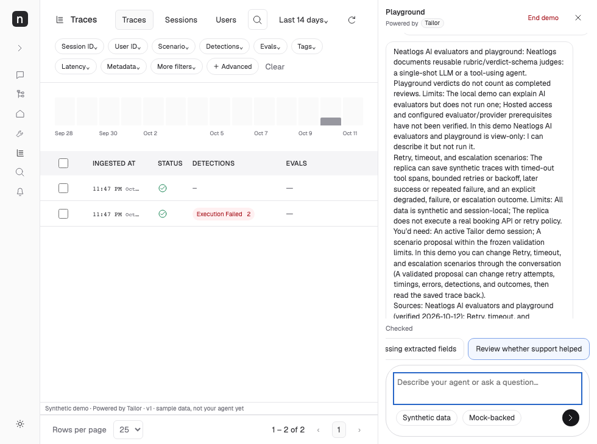

# Playground panel annotations — 12 October 2026

Follow-up to entry review commit `150c553af5ac8d674636bf8c0cf5963527509aff`, on the same isolated `codex/tailor-20261012-review-fixes` branch. The supplied annotated 980×729 screenshots are the before evidence; the 4323 server/session remains untouched.

| Comment | Fix | Files | Verification |
| --- | --- | --- | --- |
| 1 | Replace chats with Playground; place Powered by Tailor beneath it, with Tailor in a theme-aware background pill. Preserve End demo and collapse actions. | `src/clients/neatlogs/client.ts`, `public/style.css` | Header/pill assertions at 980, 1440 and 390px; collapse/reopen journey; screenshots |
| 2 | Remove both duplicate top disclosure paragraphs. Preserve server-authoritative Mock-backed / Live model / Provider status unavailable and Synthetic data in composer chips at every viewport. Overlaps 1's header cleanup. | client, CSS, `ui/agent.spec.ts` | Existing actual-provider/malformed/unavailable/forged-live-envelope tests preserved; synthetic chip restored on mobile; dark composer contrast assertion |
| 3 | Suggestions form a single horizontally scrollable row, including mobile. Keyboard focus reveals off-screen suggestions; clicking fills the editable composer without sending. | CSS, `ui/panel-review.spec.ts` | Exact nowrap/overflow/one-row geometry checks at three widths; scroll/focus/editability assertions |

[Desktop](tailor-entry-review/panel-after-1440.png) · [Mobile](tailor-entry-review/panel-after-390.png) · [Dark](tailor-entry-review/panel-after-dark.png).

Models: GPT-6.1-sol orchestration/markup/tests; GPT-6-luna bounded dock CSS; GPT-6.1-sol independent read-only review. Shared files have one owner. Reviewer caught the existing white dark-mode composer becoming the sole disclosure surface; scoped theme colors repair it. Assertions wait for the final assistant reply and sample geometry atomically to avoid detached-element reads during normal turn repaint, without relaxing layout requirements.

Focused journey/provider/forged-mode/panel tests: 4 passed; final panel viewport/dark test passed after reviewer correction. Final-commit validation logs/results are in `.local/review-evidence/panel-final-validation.json`. No policy, grounding, spend, telemetry, backend session isolation, or entry behavior was changed. No paid/hosted calls, merge, push or deployment. Entire recording remains best effort; normal Git hooks are left intact, with local linkage verified separately after committing.
