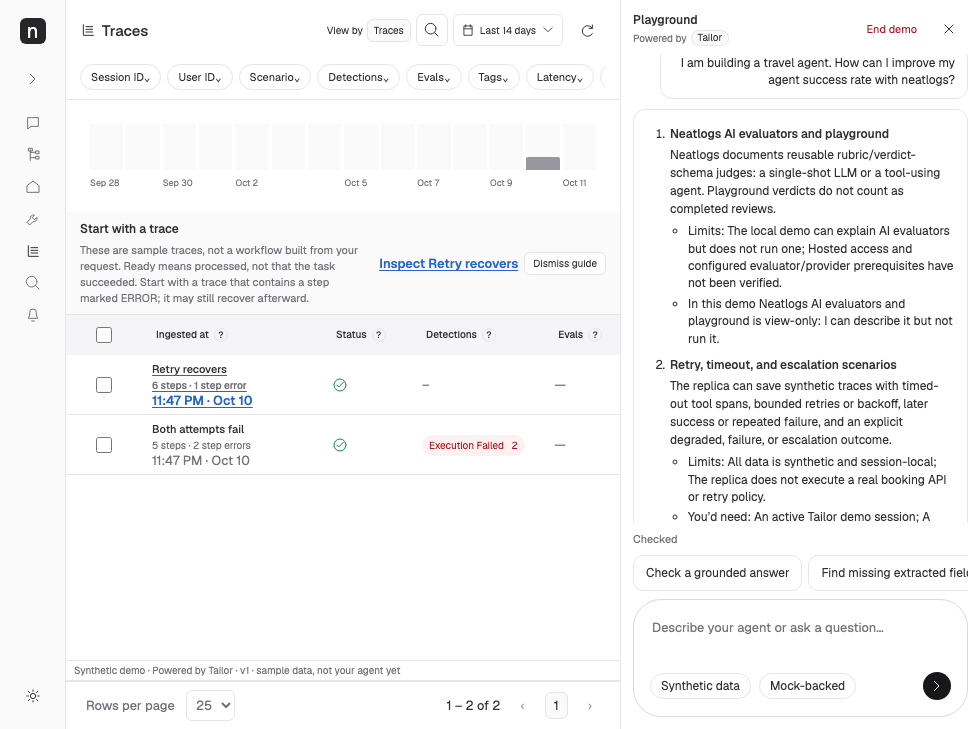

# Stepwise Tailor replies — 12 October 2026

Base `b431a8fb92e917b11dbe32b1d2639b35e286d413`; same isolated `codex/tailor-20261012-review-fixes` worktree. Port 4323 remains untouched.

- [x] Comment 1: replies are skimmable steps, with pipeline changes where necessary. New product answers are stored/API plain text with numbered capability headings, standalone behavior and bullets for limits/prerequisites/demo scope. Saved-run replies keep the exact verified-version prefix first, then separate run facts, failures and grounded evidence. Existing trace walks render as real ordered lists.

| Area | Files | Evidence |
| --- | --- | --- |
| Reply generation | `src/clients/neatlogs/answer.ts`, `explain.ts` | 135 focused backend checks including claim/adversarial filters and four new step-reply tests; no provider/schema/prompt-version change |
| Safe presentation and older conversations | `reply-format.ts`, `client.ts`, explicit `reply-format.js` route in `src/infrastructure/server.ts` | Six parser tests; real numbered headings/points; inert markup; legacy capability formatting without storage writes |
| Readable layout | `public/style.css` | 980/1440/390px and dark screenshots; scoped assistant bubble/list/detail styling; uncertainty styling retained |
| User journey | `ui/replies-review.spec.ts` | Three focused browser tests: stored reply structure, limits/uncertainty/source details, exact evidence link, trace walk, reload and unchanged conversation after legacy rendering |

All factual wording, capability limitations, prerequisites, demonstration scope, source dates, knowledge version, plan statements and evidence IDs are retained. Plan lines stay last in stored/API replies; unknown availability is also stated in the collapsed reference summary. Pricing refusal remains visible outside reference details. The browser never interprets arbitrary HTML or Markdown. Short refusal/clarification text remains simple. Historical records are not migrated or rewritten.

Only three old title-colon assertions were updated to require numbered headings plus the same sourced behavior. Existing verified-save prefix, adversarial leakage, uncertainty, identity and citation assertions remain intact.

[Desktop](tailor-replies-review/replies-after-1440.png) · [Mobile](tailor-replies-review/replies-after-390.png) · [Dark assistant reply](tailor-replies-review/replies-after-dark.png). The supplied annotated image is before evidence. Existing dark buyer-bubble contrast is outside this assistant-reply change.

Models/ownership: GPT-6.1-sol backend agent owns answer/explanation composition and backend tests; GPT-6-luna owns CSS; GPT-6.1-sol orchestrator owns renderer/parser/module serving/browser checks/evidence; GPT-6.1-sol independent reviewer is read-only. No shared-file concurrent edits. Root added the scoped uncertainty cue after CSS ownership returned. Independent review caught and verified the fix for source-looking text in saved tool evidence: evidence-bearing replies never fold provenance, and only a trailing product metadata footer can become source details.

Final-commit typecheck, build, full unit and browser results/logs are in `.local/review-evidence/replies-final-validation.json`. Mock provider and captured local telemetry only, paid/hosted keys removed for final tests/preview. No merge, push, deployment or paid E2E. Entire remains best effort: caller lookup resolved an ended ancestry record on original 788e; review-worktree live capture is unverified. Genuine normal-hook local checkpoint evidence is checked after the authorized commit without manual hooks/imports/trailers/history rewrite.
