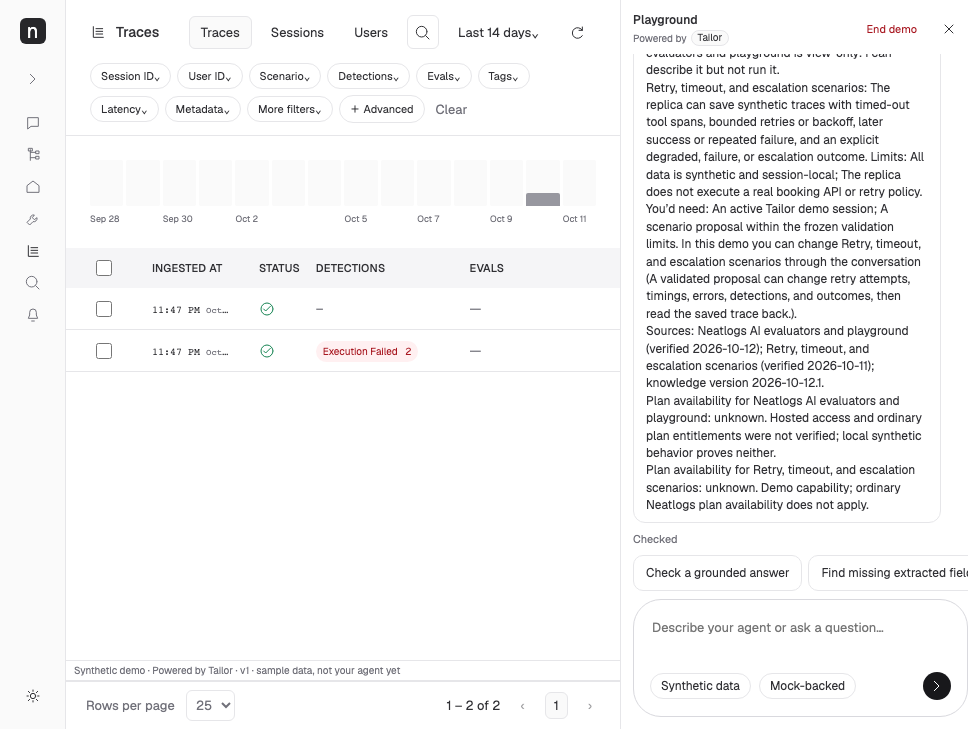
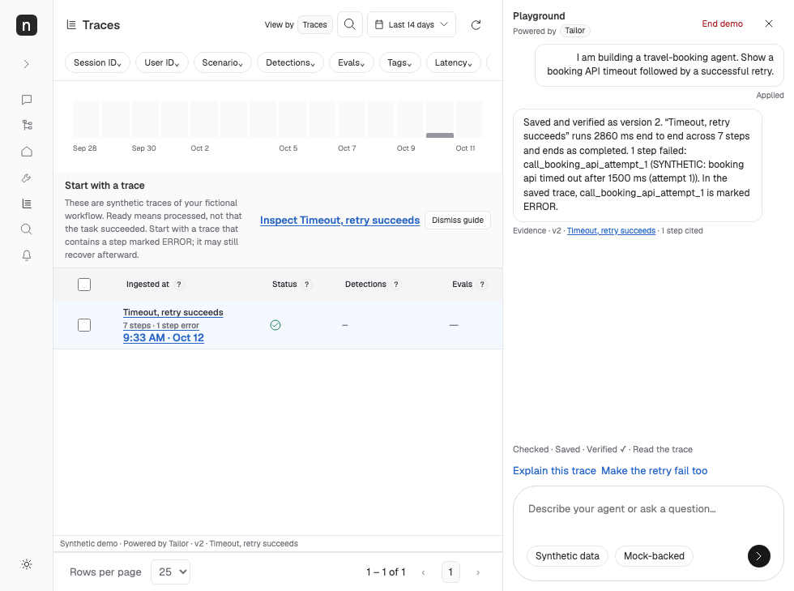

# Trace-list annotations — 12 October 2026

Base `6c6f8a2028b34b2e0ee12332f9528fa925199b87`; branch `codex/tailor-20261012-review-fixes` in the isolated review worktree. Port 4323 and existing worktrees are preserved.

| Comment | Fix | Files | Verification |
| --- | --- | --- | --- |
| 1 | Single horizontally scrolling filter row; responsive header uses actual workspace width; dropdowns open outside the scrolling strip with bounded placement and one editor at a time. Existing scenario/detection/tag/latency filtering retained. | `public/style.css`, `src/clients/neatlogs/client.ts` | 980/1440/390px containment, exact popup anchor checks, filter apply/clear journey |
| 2 | Compact 32px bordered date control with calendar and down-chevron. Remains visible in narrow workspaces; explicitly describes fixed demo dates and points users to supported filters rather than pretending to change dates. | CSS, client | Three viewport checks, unchanged URL and truthful fixed-range feedback |
| 3 | Start with a trace guide, readable label/counts for each row, highlighted actual trace/step link, explanatory keyboard/hover/touch field help, and detail guidance for input → saved step → output. Guide dismiss/reopen is per demo. Full saved detail data remains available. | client, `trace-guide.ts`, helper unit tests, `ui/traces-review.spec.ts`, explicit helper route in `src/infrastructure/server.ts` | Grounded counts/recommendations, filtered-result boundaries, keyboard/touch/Escape/fallback, dismissal reload/scope, collapsed-ancestor recovery, mobile CTA placement and dark readability |

Official reference https://app.neatlogs.com/traces was inspected read-only in the authorized Tailor project, including a 980×729 viewport. It uses a compact header, 32px bordered date button and a 28px single-row filter toolbar with horizontal overflow. Temporary reference viewport override was reset. These layout relationships were preserved; local Scenario/Tags filters were not falsely relabeled as official Workflow functionality.

Guide truth: Ready establishes processing, not successful task completion. Step errors are counted from saved `status=ERROR` separately from detections. Recommendations use visible filtered results and actual saved span IDs. Output preview says “Reported outcome” only when the saved output contains an outcome; otherwise it invites inspection, without inferring success. Sample traces are explicitly distinguished from a workflow built from the visitor’s request.

Independent review caught and resolved full-label help buttons in tiny icon boxes, fallback Escape dismissal, and guided steps hidden under collapsed parents. Route-only ancestor revelation now exposes the requested path while respecting subsequent manual collapse. The ancestor walk is bounded for cycles/missing parents. Dark guided links and active-row contrast were corrected within this list’s scope. Existing dark message-bubble contrast is unchanged and remains a separate limitation.

Models/ownership: GPT-6.1-sol behavior agent owns client/helper/unit tests; GPT-6-luna owns CSS; GPT-6.1-sol orchestrator owns module serving/browser tests/evidence; GPT-6.1-sol reviewer is read-only. Five focused helper tests and six focused browser tests pass. Final-commit typecheck/build/full unit/full browser logs and result JSON are in `.local/review-evidence/traces-final-validation.json`.

[Desktop before](tailor-traces-review/traces-before-1440.png) · [Desktop after](tailor-traces-review/traces-after-1440.png) · [Mobile before](tailor-traces-review/traces-before-390.png) · [Mobile after](tailor-traces-review/traces-after-390.png) · [Dark list](tailor-traces-review/traces-after-dark.png) · [Mobile detail guide](tailor-traces-review/traces-detail-guide-mobile.png).

No backend policy, grounding, spend or telemetry changes. Mock/captured testing only; no paid calls, hosted exports, merge, push, deployment or history rewrite. Preview is left at port 4325; exact URL is in the final response. Entire is best effort: caller metadata at this turn resolved via ancestry to an ended record on the original Codex worktree, so live capture of this review worktree is unverified. Normal Git-hook checkpoint evidence is checked separately after committing; no trailer is manufactured.

Final-suite follow-up: mobile detail guidance initially overflowed at 512px; bounded wrapping repaired it, and the original 390px assertion remains intact. An existing test extracted a trace ID from the entire URL including the new span query; it now uses URL.pathname while retaining exact asking-about and cited-trace assertions. Four focused regression checks pass. The first failed run is preserved in `.local/review-evidence/traces-first-final-browser.log` and its result JSON; final results are rerun on the follow-up commit.
