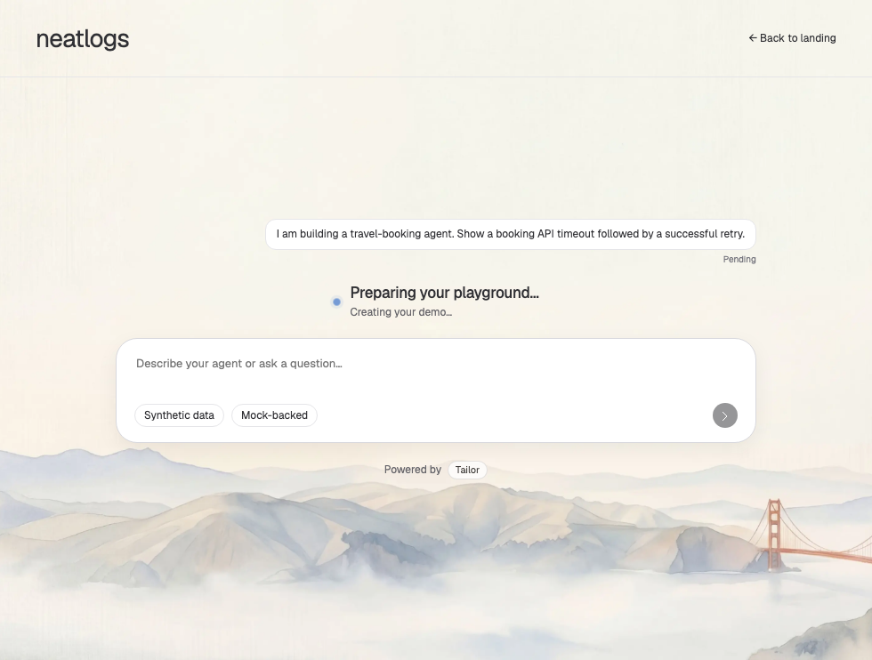

# First-prompt transition annotation — 12 October 2026

Base `1ab0ac22c3c6e2c4698310b21d72588422792e3e`; isolated branch `codex/tailor-20261012-review-fixes`. Port 4323 and its browser session remain untouched.

- [x] Comment 1: smooth first-prompt entry-to-demo transition with meaningful progress. The submitted prompt remains visible during “Creating your demo…” and “Loading your demo…”. The entry view stays in place through authoritative session/trace reads, then a scoped 220ms native View Transition fades into the Playground. “Working on your request…” is shown while the actual first turn is pending. No fake model thoughts, simulated percentage, artificial wait, or early success claim.

Files: `src/clients/neatlogs/client.ts` owns preparation state, readiness, first-turn durability and native/fallback rendering; `public/style.css` owns the compact loading status and scoped motion; `ui/transition-review.spec.ts` verifies the journey and recovery.

Reference: linked Neatlogs conversation was inspected read-only at https://app.neatlogs.com/ai-search/3c6c4c77-6784-43c7-9288-ce9c8500a091. Its user prompt, Analysis disclosure, response and composer informed continuity. No reference prompt was submitted and no claim is made that its live loading animation was reproduced exactly. The supplied annotation screenshot is before evidence.

Focused browser checks: 7 passed. Coverage includes gated create/read/turn stages, one create and one turn, original prompt visible, honest mode/synthetic chips, no generic loading-page flash, original idempotency on retry, reduced-motion/unsupported native API, throwing API fallback, interrupted create/metadata completion, and failed trace read recovery with the same original clientTurnId. Interrupted tests await released network completion and a browser frame before checking that no hidden redirect/send occurred.

Independent review found and resolved a recovery gap: the original first-turn request is now persisted immediately after creation, before draft cleanup and metadata reads. Navigation tokens prevent stale completions from redirecting or sending, and cleanup is scoped to the original pending request. No backend policy, provider, spend, grounding, or telemetry changes. Shared file ownership: GPT-6.1-sol behavior agent owns client; GPT-6-luna owns CSS; GPT-6.1-sol orchestrator owns tests/evidence; GPT-6.1-sol reviewer is read-only.

[Loading](tailor-entry-review/transition-opening.png) · [Working in Playground](tailor-entry-review/transition-working.png) · [Mobile preparation](tailor-entry-review/transition-creating-mobile.png).

Final-commit typecheck, build, full unit and full browser logs/results are recorded in `.local/review-evidence/transition-final-validation.json`. Preview remains http://127.0.0.1:4325/entry in mock mode with captured local telemetry, paid-provider and hosted-export keys absent. No merge, push, deploy, or paid E2E.

Entire is best effort: caller metadata showed fresh turns for the original Codex 788e worktree during this task. Review worktree/session linkage and local commit checkpoint evidence are checked separately after the normal Git hook; no manual hooks, imports, manufactured trailers, or history rewrite.
